# Quickshell

**English** | [Русский](README.ru.md)

> **Mostly written by AI.** The QML, the installer, the docs and this README
> were produced with AI assistance and reviewed by a human. Treat it as a
> personal config that happens to be public, not as a supported product.

A complete Material 3 Expressive desktop shell for [niri](https://github.com/YaLTeR/niri),
built with [Quickshell](https://quickshell.org/). One QML config replaces the
bar, launcher, clipboard manager, notification daemon, quick settings, OSD,
wallpaper manager and power menu.

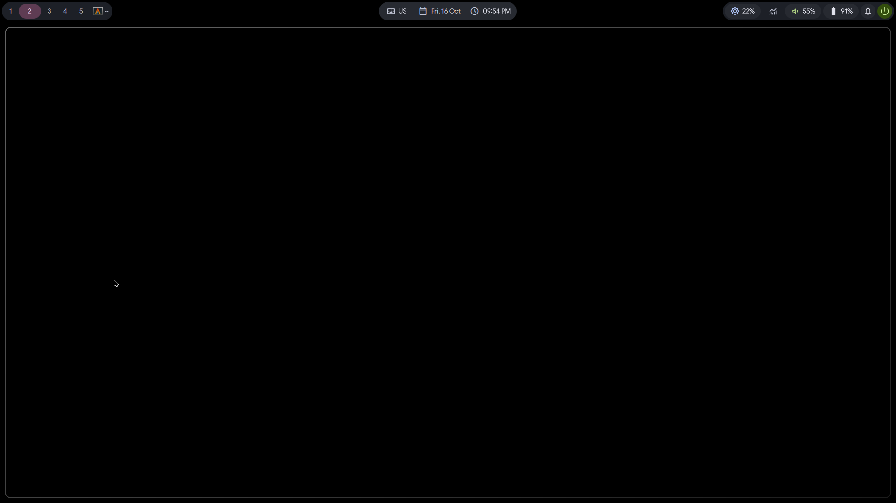

The palette comes from the wallpaper through [matugen](https://github.com/InioX/matugen)
and is written onto the rest of the desktop too: GTK3/GTK4 apps, Qt apps,
ghostty and the niri border and focus ring.

The interface strings are currently Russian; the QML code and these docs are
English (except for the Russian README).

## What you get

- **Bar** — workspaces, window title, clock (timer/stopwatch) and date
  (weather), keyboard layout, volume, brightness, battery, notifications, the
  system tray and a power button. Three layouts: three floating islands, one
  floating plate or one plate flush to the screen walls.
- **Launcher** — applications, arithmetic and `Terminal=true` desktop entries,
  with a configurable terminal (`$TERMINAL`, `alacritty` by default).
- **Clipboard history** — `cliphist` + `wl-clipboard`, with images and text.
  Ctrl+P opens the actions menu; pinning stores a decoded snapshot in the shell
  data directory, so pins survive `cliphist wipe`.
- **Notifications** — Quickshell is the notification daemon; toast popups,
  history persisted across restarts, do-not-disturb, per-app mute and a
  notification center.
- **Quick settings** — volume, audio output switching, microphone mute,
  brightness, Wi-Fi, night light, do-not-disturb, MPRIS media, power profiles,
  UI language (RU/EN/DE), theme/style/colorscheme/font controls and the power
  menu.
- **Lock screen** — current wallpaper, clock card and a PAM password field on
  `ext-session-lock-v1`; locks after 5 idle minutes and powers the monitors off
  after 7.5.
- **Wallpaper manager** — recursive library, cached previews, favorites,
  random wallpaper, drag-and-drop from the desktop or the bar.
- **Desktop pet** — a draggable Tux that chats through NVIDIA NIM, answers
  time/date/weather/battery questions locally, sleeps when idle and reacts to
  notifications, low battery and mute.
- **OSD and system popup** — volume/brightness overlay (also for changes made
  with `wpctl`/`brightnessctl`), CPU, RAM, temperature and GPU rows (AMD via
  sysfs, `nvidia-smi` fallback).
- **Seven style packs** — `M3 Inspired`, `M3 Blur`, `New` (graphite acrylic),
  `Nothing` (opaque graphite, hard corners), `New Nothing` (the same graphite
  with the acrylic dressing and blur), `Old` (retro gray/charcoal chrome with
  square corners and bevels) and `Custom` (your own palette and knobs: corner
  ladder, bar/chip radii, acrylic, shadow, outline and bevels).
- **Light and dark** — a second matugen pass writes the light palette; the
  shell switches both its own colors and the desktop.

## Requirements

- Wayland with **niri**. Other compositors can run the QML, but workspaces,
  window titles and the keyboard layout come from `niri msg`.
- Arch Linux for the installer (`pacman`). The manual route works on other
  distributions with the same packages.
- Quickshell **0.3.2 or newer** (developed against 0.3.2 and niri 26.04).

## Screenshots

| Weather | Calendar |
|:---:|:---:|
| 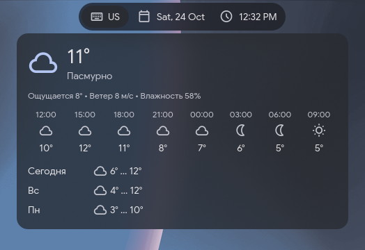 | 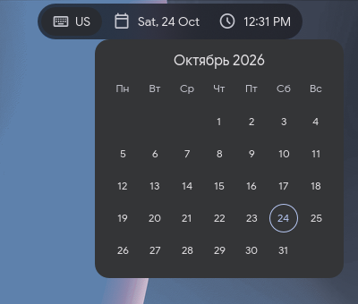 |

| Quick settings | Power menu |
|:---:|:---:|
| 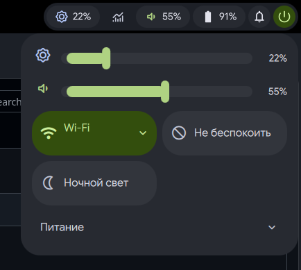 | 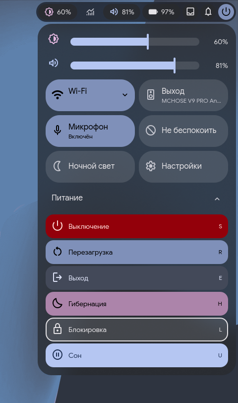 |

| OSD | Keyboard layout |
|:---:|:---:|
| 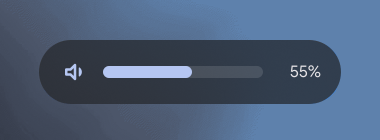 | 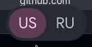 |

| Launcher | Clipboard history |
|:---:|:---:|
| 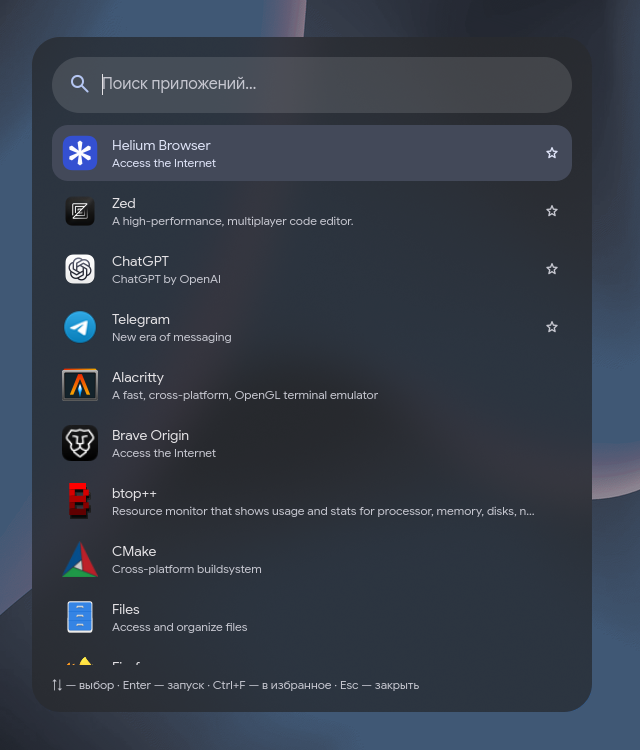 | 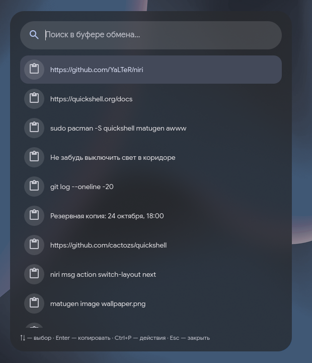 |

| Settings menu | Wallpaper manager |
|:---:|:---:|
| 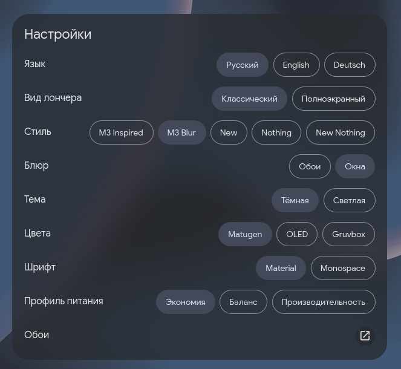 | 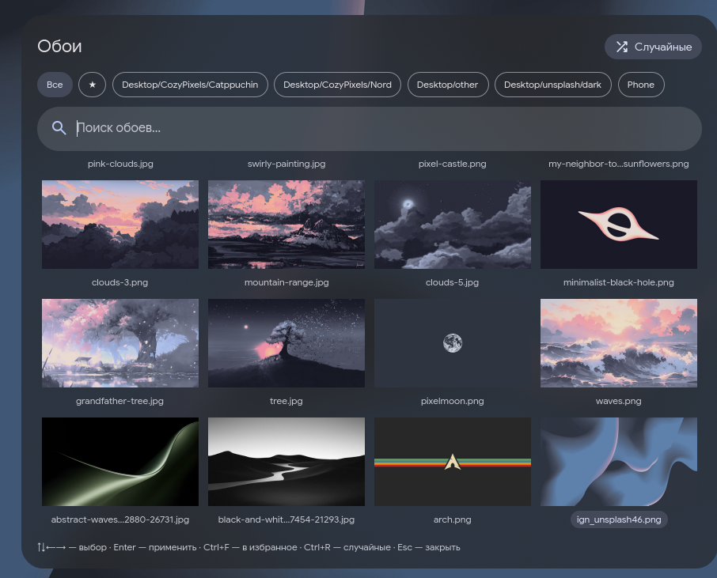 |

## Quick start

### Installer (recommended)

```sh
git clone https://github.com/cactozs/quickshell.git ~/.config/quickshell
cd ~/.config/quickshell
./install.sh
```

The installer is deliberately conservative:

| step | what it does | skip it with |
|---|---|---|
| packages | installs the missing Arch packages with `pacman -S --needed` | `--no-packages` |
| fonts | downloads **Google Sans** to `~/.local/share/fonts/` if it is missing; the Old font comes from `gsfonts` | `--no-fonts` |
| matugen | writes `~/.config/matugen/config.toml`, `light.toml` and the template with **absolute paths to this checkout** | — |
| shim | installs `/usr/local/bin/awww`, backing up an existing file | `--no-shim` |
| directories | creates `~/Pictures/Wallpapers` and the config folders the theme writer uses | — |
| niri | adds the `quickshell.kdl` include, autostart entries and `QT_QPA_PLATFORMTHEME`, with backups | `--no-apply` |
| ghostty | adds `theme = Quickshell` if there is no theme yet | `--no-apply` |
| qt6ct | adds `color_scheme_path` if it is not set yet | `--no-apply` |
| keybinds | **prints** the binds; it never edits `keybinds.kdl` | always |

Existing files are copied to `file.bak.YYYYmmdd-HHMMSS.PID` before an edit.
Running the installer twice is safe: it only writes when the content differs.

If you cloned somewhere other than `~/.config/quickshell`, either run
`./install.sh --link` (creates the symlink when the path is free) or start the
shell with `quickshell -p /path/to/quickshell`. The matugen output paths are
always rewritten to the absolute checkout path, so `--link` is not required for
recoloring; it is only what makes plain `quickshell` and `qs ipc` find the config.

Check the environment at any time:

```sh
./install.sh --check     # writes nothing
qs ipc show              # live IPC targets of a running shell
qs log                   # stderr of the running shell
```

### Manual installation

Use this if you want to see every change (or are not on Arch).

#### 1. Clone

```sh
git clone https://github.com/cactozs/quickshell.git ~/.config/quickshell
```

Quickshell treats `~/.config/quickshell` as its default config directory.
If you clone elsewhere, symlink it:

```sh
ln -s /path/to/quickshell ~/.config/quickshell
```

or run `quickshell -p /path/to/quickshell` and pass `toggleOn` as shown in
[keybinds](#keybinds).

#### 2. Packages

```sh
sudo pacman -S --needed \
  quickshell niri matugen awww \
  fd ripgrep jq curl cliphist wl-clipboard brightnessctl \
  pipewire wireplumber upower power-profiles-daemon networkmanager \
  ttf-material-symbols-variable ttf-nerd-fonts-symbols ttf-jetbrains-mono-nerd \
  alacritty gtk3 gtk4 qt6ct ghostty \
  imagemagick wlsunset playerctl
```

Optional:

```sh
sudo pacman -S papirus-icon-theme   # app icons; hicolor comes with quickshell
sudo pacman -S nvidia-utils         # GPU rows on NVIDIA; AMD needs no extra package
```

`imagemagick` only builds the 720 px wallpaper previews. Without it the manager
loads the original files, which is slow for 4K images but still works.

#### 3. Fonts

Material Symbols and Symbols Nerd Font come from pacman:

```sh
sudo pacman -S ttf-material-symbols-variable ttf-nerd-fonts-symbols ttf-jetbrains-mono-nerd
```

The default UI font, **Google Sans**, has no Arch package:

```sh
mkdir -p ~/.local/share/fonts
curl -L -o ~/.local/share/fonts/GoogleSans.ttf \
  "https://raw.githubusercontent.com/google/fonts/main/ofl/googlesans/GoogleSans%5BGRAD%2Copsz%2Cwght%5D.ttf"
fc-cache -f
fc-match "Google Sans"        # must print Google Sans, not a fallback
```

The **Monospace** option in the settings menu is **JetBrainsMono Nerd Font
Mono**, installed by `ttf-jetbrains-mono-nerd`. If it is missing, monospace mode
falls back to the default sans.

The **Old** option is **Nimbus Mono PS** from `gsfonts` — a Courier-style
monospace with Cyrillic, installed by the packages step:

```sh
sudo pacman -S gsfonts
fc-match "Nimbus Mono PS"      # must print Nimbus Mono PS, not a fallback
```

#### 4. matugen

The shell reads its colors from `style/Colors.json` (dark) and
`style/ColorsLight.json` (light). matugen writes them. The configs live in the
repository under `install/matugen/`:

```sh
mkdir -p ~/.config/matugen
cp -r install/matugen/. ~/.config/matugen/
```

Then edit `~/.config/matugen/config.toml`:

```toml
[config]
version_check = false
source_color_index = 0
fallback_color = "#6750A4"

[config.wallpaper]
set = true
command = "/usr/bin/awww img --transition-type center {{ image }}"

[templates.quickshell]
input_path = "/home/you/.config/matugen/templates/quickshell.json"
output_path = "/home/you/.config/quickshell/style/Colors.json"
type = "SchemeContent"
```

`light.toml` is the same template with `ColorsLight.json` as the output and
**no** `[config.wallpaper]`: regenerating light colors must not re-apply the
wallpaper. matugen takes the mode from the command line only, so the light pass
is a separate `matugen -m light` invocation.

Generate the first palette from any image:

```sh
matugen image ~/Pictures/Wallpapers/your-wallpaper.png
```

The absolute `command` path matters. The shim in `/usr/local/bin/awww` calls
`matugen image`, and matugen's wallpaper command calls `/usr/bin/awww`; a
relative `awww` there would loop.

#### 5. The awww shim

`awww img <file>` must go through matugen, or the colors never follow the
wallpaper. `/usr/local/bin` is ahead of `/usr/bin` in the normal PATH:

```sh
sudo install -Dm755 install/awww /usr/local/bin/awww
command -v awww               # must print /usr/local/bin/awww
```

The shim intercepts only plain `awww img <existing-file>`. `query`, `restore`,
`pause`, extra flags and color values go straight to `/usr/bin/awww`.

#### 6. niri

Create the generated file before including it, otherwise niri refuses to start:

```sh
touch ~/.config/niri/quickshell.kdl
```

`~/.config/niri/config.kdl` — the include must come after `layout.kdl`, because
niri merges includes positionally and the generated border colors have to win:

```kdl
include "layout.kdl"
include "quickshell.kdl"
```

`~/.config/niri/autostart.kdl`:

```kdl
spawn-at-startup "quickshell"
spawn-at-startup "awww-daemon"
spawn-at-startup "sh" "-c" "wl-paste --type text --watch cliphist store"
spawn-at-startup "sh" "-c" "wl-paste --type image --watch cliphist store"
```

Idle locking, monitor power-off and locking before suspend all live in the
shell itself.

If you already launch Quickshell with environment variables, keep that line
instead of adding a second one. For example:

```kdl
spawn-at-startup "sh" "-c" "env QT_QUICK_BACKEND=software quickshell"
```

`~/.config/niri/environment.kdl`:

```kdl
environment {
    QT_QPA_PLATFORMTHEME "qt6ct"
}
```

#### 7. ghostty and Qt

`~/.config/ghostty/config`:

```ini
theme = Quickshell
```

`~/.config/qt6ct/qt6ct.conf` (create it if qt6ct has no config yet):

```ini
[Appearance]
color_scheme_path=/home/you/.config/qt6ct/colors/matugen.conf
custom_palette=true
```

The shell writes the file that path points at on its first run. Qt applications
read the palette at startup, so restart them after a theme change. The shell
reloads ghostty with `SIGUSR2`.

The power menu's **Lock** entry runs `qs ipc call lock lock`; bind the same
command to a key. The built-in lock screen shows the current wallpaper behind a
dim scrim, with a card holding the clock, date, user and a password field. It
takes a real `ext-session-lock-v1` lock and checks the password against PAM's
system `login` stack, so there is no extra locker package and no `/etc/pam.d`
change.

The shell locks itself after 5 idle minutes, powers the monitors off after 7.5
(any input wakes them) and locks before suspend through logind's
`PrepareForSleep`, holding a delay inhibitor until the lock is up. No `swayidle`
is involved. There is deliberately no IPC to unlock — only the password ends
the lock.

#### 8. Wallpapers, weather and terminal

```sh
mkdir -p ~/Pictures/Wallpapers
```

Put images there. Dropping one on the bare desktop or the bar applies it too.

Local edit points:

| what | where | default |
|---|---|---|
| wallpaper folder | `services/Wallpapers.qml` → `rootDir` | `~/Pictures/Wallpapers` |
| weather coordinates | `services/Weather.qml` → `lat`, `lon` | Moscow (`55.75`, `37.62`) |
| terminal for desktop entries | `$TERMINAL`, then `modules/Launcher.qml` | `alacritty` |

`$TERMINAL` is split on spaces, so `TERMINAL="ghostty --class=foo"` works.

#### 9. Run

```sh
quickshell
```

Run it in the foreground first. There is no build and no test suite: QML errors
appear on stderr, and the shell reloads itself when a file changes. GitHub
Actions runs `qmllint`, `bash -n install.sh` and `python3 scripts/check-qml.py`
on pushes and pull requests.
Once it works, keep the niri autostart line and stop the manual instance.

## Keybinds

Put these in `~/.config/niri/keybinds.kdl`. They are `qs ipc` calls, so the
shell must be running. `toggleOn` opens the panel on the focused monitor; it
needs `niri` and `jq`.

```kdl
Mod+A       repeat=false { spawn-sh "qs ipc call launcher toggleOn $(niri msg --json focused-output | jq -r .name)"; }
Mod+V       repeat=false { spawn-sh "qs ipc call clipboard toggleOn $(niri msg --json focused-output | jq -r .name)"; }
Mod+N       repeat=false { spawn-sh "qs ipc call center toggleOn $(niri msg --json focused-output | jq -r .name)"; }
Mod+Ctrl+W  repeat=false { spawn-sh "qs ipc call wallpaper toggleOn $(niri msg --json focused-output | jq -r .name)"; }
Mod+Shift+N repeat=false { spawn "qs" "ipc" "call" "notifs" "toggleDnd"; }
Mod+P       repeat=false { spawn "qs" "ipc" "call" "bar" "toggle"; }
Mod+Alt+L   repeat=false { spawn "qs" "ipc" "call" "lock" "lock"; }
```

Without niri/jq, replace `toggleOn $(…)` with `toggle`; the panel then opens on
the first screen. Esc and a click outside close an open panel.

Volume, brightness and media binds do not go through the shell: use `wpctl`,
`brightnessctl` and `playerctl` directly. Lock does: `qs ipc call lock lock`.

## IPC

`qs ipc show` prints the live list. The overlay targets share `toggle`,
`toggleOn <output>` and `close`; `bar` and `notifs` are separate:

| target | extra functions |
|---|---|
| `launcher` | — |
| `clipboard` | — |
| `center` (notifications) | — |
| `tray` | — |
| `weather` | — |
| `clock` (timer and stopwatch) | — |
| `system` (monitoring) | — |
| `settings` (quick settings) | `launcherView <bool>`, `style <m3\|blur\|new\|nothing\|newNothing\|old>`, `panel <islands\|island\|panel>`, `panelwidth <full\|fit>`, `colorscheme <matugen\|oled\|gruvbox>`, `theme <dark\|light>`, `font <material\|mono\|old>`, `animations <normal\|slow\|off>`, `nirianimations <normal\|slow\|off>`, `windowsradius <0-24>`, `blur <wallpaper\|window>`, `ambient <off\|xmas>`, `language <ru\|en\|de>` |
| `wallpaper` (manager) | `random` |
| `pet` (desktop pet) | — |
| `lock` (lock screen) | `lock` |
| `bar` | `toggle` |
| `notifs` | `toggleDnd`, `dnd`, `clear`, `mute <app>`, `unmuteAll` |

`<output>` is a monitor name (`"eDP-1"`, see `niri msg outputs`), not a number.
Examples:

```sh
qs ipc call launcher toggle
qs ipc call settings theme light
qs ipc call settings colorscheme gruvbox
qs ipc call settings style new
qs ipc call wallpaper random
qs ipc call notifs toggleDnd
qs ipc call lock lock
```

## Theming

The shell owns the palette, and `services/SystemTheme.qml` is the single writer:

- `~/.config/gtk-3.0/gtk.css` and `~/.config/gtk-4.0/gtk.css`
- `~/.config/ghostty/themes/Quickshell` (reloaded with `pkill -USR2 -x ghostty`)
- `~/.config/qt6ct/colors/matugen.conf`
- `~/.config/niri/quickshell.kdl` — niri border and focus-ring colors, plus the
  `layer-rule` that selects the blur source and the `animations` switch
- `gsettings set org.gnome.desktop.interface color-scheme …`

A file is written only when its content changes. Hand edits survive until the
next theme change, then they are regenerated.

Which of these targets are written at all is the "Applications" tab in the
settings menu (or `qs ipc call settings app ghostty false`). A disabled target
is left alone: its file keeps whatever colors it last got.

**Light mode** is a second matugen pass. The shell runs
`matugen -m light image <wallpaper> -c ~/.config/matugen/light.toml` when the
dark palette is newer than `ColorsLight.json`. The two configs must keep the
same source-color settings; `light.toml` intentionally has no wallpaper command.

**Blur** is niri policy. «Обои» (the default) is niri's xray blur: the wallpaper
alone. «Окна» writes `xray false` into the generated `layer-rule`, so windows
under the acrylic plates blur too. The choice is read back from
`~/.config/niri/quickshell.kdl` at shell start, so it survives a reboot.

**Animations** are two settings. «Анимации» is the shell's own motion
(`qs ipc call settings animations <normal|slow|off>`): `Slow` stretches every
duration by 1.6, `Off` zeroes them (the hardcoded ones go through `Theme.dur()`),
and the seasonal ambient dressing keeps its own. «Анимации niri» is the
compositor's (`qs ipc call settings nirianimations <normal|slow|off>`): `Normal`
writes nothing, so niri keeps the `animations` block from your own
`animations.kdl`; `Slow` writes `slowdown 1.0`, `Off` writes `animations { off }`.

**Window rounding** (`qs ipc call settings windowsradius <0-24>`) is a niri
window rule written into that same generated file. Untouched, it writes nothing,
so your own `window-rules.kdl` keeps its radius; the first slide takes over and
clips the windows to the rounded geometry too.

**Style packs** are switched in the settings menu or with
`qs ipc call settings style …`. `M3 Inspired` is the matugen palette with the
M3 shape scale, `M3 Blur` adds acrylic plates and compositor blur, `New` is
graphite acrylic, `Nothing` is opaque graphite with hard corners, and
`New Nothing` is that graphite and those corners with the New acrylic dressing —
rim, specular, drop shadow and blur. `Old` is the retro pack: gray/charcoal
plates with light and dark twins, square corners, a black hairline and
raised/sunken bevels, no blur, shadow or motion. The accent roles come from the
current matugen palette and the plates take a faint tint of its primary, so a
wallpaper change recolors the selection and buttons while the chrome stays gray.
It keeps the current font; pick **Old** for the Courier look.

`Custom` is the hand-built pack: the **Custom** settings tab edits one M3
palette for both light and dark (click a role to open an HSV picker; **Готово**
commits, **Сброс** restores that role) and the knobs for the corner ladder
(`Скругление`), bar and chip radii, acrylic and its opacity, shadow strength,
blur and offset, the outline and the bevels. The palette's `surface` luminance
decides whether the light terminal/desktop derivations apply. Everything is
stored sparsely in `shell-state.json` under `custom`; `Сброс → Всё` clears it.
The `Тема` and `Цвета` rows are hidden while Custom is active because the pack
owns both.

## Configuration

| what | file / key |
|---|---|
| overlays and screens | `shell.qml` (`Variants` per `Quickshell.screens`) |
| wallpaper folder | `services/Wallpapers.qml` → `rootDir` |
| weather location | `services/Weather.qml` → `lat`, `lon` |
| terminal | `$TERMINAL`; fallback in `modules/Launcher.qml` |
| fonts | `style/Theme.qml` → `fontFamily`, `iconFont`, `nerdFont` |
| UI translations | `services/I18n.qml` |
| style, palette, bar layout (islands/island/panel), bar position (top/left/bottom/right), light/dark, font mode, animations (shell and niri), language | settings menu, or `qs ipc call settings …` |
| Custom style palette and knobs | Custom tab in the settings menu; stored under `custom` in `shell-state.json` |
| matugen dark/light configs | `~/.config/matugen/config.toml`, `light.toml` |
| generated niri colors | `~/.config/niri/quickshell.kdl` |
| desktop theme writer | `services/SystemTheme.qml` |
| system stats | `services/SystemMonitor.qml` |
| notifications | `services/Notifications.qml` |
| pinned clipboard entries | `services/ClipboardPins.qml` (shell data directory) |
| IPC handlers | `services/ShellState.qml` |

`launcher-usage.json`, `notifications.json`, `wallpaper-favorites.json`,
`shell-state.json` and `.qmlls.ini` are local runtime state and are gitignored.
`style/Colors.json` and `style/ColorsLight.json` are generated palettes, but
they are tracked so a fresh clone has a usable fallback until matugen runs.

## Desktop pet

The paw button in the bar shows Tux on its screen (`qs ipc call pet toggle`
from a keybind). Drag him anywhere; the spot is saved per shell. Click to open
the chat, double-click to pet him, and he sleeps after five idle minutes. The
window hides itself while a fullscreen window is focused.

Answers come from NVIDIA NIM (`integrate.api.nvidia.com`), or from the shell
itself for time, date, weather and battery. The key is read from
`NVIDIA_API_KEY` in the shell's environment; there is no key field in the
settings menu:

```sh
set -Ux NVIDIA_API_KEY nvapi-...
```

The shell inherits the variable when it starts, so restart it after exporting.

The pet remembers the last few messages and can use three tools:

- `run_diagnostic` runs one read-only command: kernel, free space, disks,
  memory, network addresses, failed systemd units, the last lines of `qs log`,
  or a listing of a folder inside your home. Hidden folders and anything
  outside `$HOME` are refused; there is no `cat`, `find` or shell.
- `grep_shell` searches this repository and answers with `file:line`, so
  questions about the config are checked against the real files.
- `shell_action` opens a panel, switches the theme, changes the volume, mutes
  the sound or takes a screenshot. It only runs when you ask for it.

Every question, every command output and every listed file name goes to
NVIDIA. Without a key the pet still answers the local questions.

## Troubleshooting

| symptom | cause | fix |
|---|---|---|
| text is the default sans | Google Sans is missing | install it (step 3), then `fc-cache -f` |
| icons are empty boxes | Material Symbols is missing | `sudo pacman -S ttf-material-symbols-variable` |
| the bar stays purple | matugen never ran, or `output_path` points elsewhere | fix `~/.config/matugen/config.toml`, run `matugen image <file>` |
| wallpaper changes, colors do not | the `awww` shim is missing or shadowed | `command -v awww` must print `/usr/local/bin/awww`; reinstall the shim |
| `awww img` does nothing | `awww-daemon` is not running | add `spawn-at-startup "awww-daemon"` |
| a panel opens on the wrong monitor | the bind uses `toggle` | use `toggleOn $(niri msg --json focused-output \| jq -r .name)` |
| blur does nothing | missing niri include, or the style paints no acrylic | step 6; try `M3 Blur` and «Окна» |
| Qt apps keep old colors | Qt reads the palette at startup | restart them |
| light mode does not update | `light.toml` missing or `ColorsLight.json` stale | rerun `./install.sh`, then change the wallpaper |
| `qs ipc` cannot connect | shell is not running, or the checkout is elsewhere | `qs ipc show`; run `./install.sh --link` or `quickshell -p <path>` |
| the shell will not start | QML error | run `quickshell` in a terminal and read stderr; `qs log` for a running instance |

If you edit QML, keep a terminal with `quickshell` open. A syntax error leaves
the previous configuration on screen and prints the file and line in the log.

## Update

```sh
cd ~/.config/quickshell
git pull --ff-only
./install.sh
```

The installer rewrites the matugen paths if the checkout moved, and writes a
config file only when its content differs or a required entry is missing. If
you use `--no-apply`, compare `install/matugen/` with `~/.config/matugen/` and
the snippets in this README by hand.

## Uninstall

Stop the shell and remove the autostart line first:

```sh
pkill -x quickshell
```

Then remove what you no longer want:

```sh
sudo rm /usr/local/bin/awww             # restore awww.bak.* if one exists
rm -rf ~/.config/quickshell             # the checkout
rm -rf ~/.config/matugen                # matugen configs
rm -f  ~/.config/niri/quickshell.kdl
rm -f  ~/.config/ghostty/themes/Quickshell
rm -f  ~/.config/qt6ct/colors/matugen.conf
rm -f  ~/.config/gtk-3.0/gtk.css ~/.config/gtk-4.0/gtk.css
```

Remove `include "quickshell.kdl"` and the autostart lines from niri by hand. Backups made by the installer are next to the original files as
`*.bak.YYYYmmdd-HHMMSS.PID`. The wallpaper library and installed packages are
left alone.

## Credits

- [Quickshell](https://quickshell.org/) — the shell toolkit and `qs` IPC.
- [niri](https://github.com/YaLTeR/niri) — the compositor this is built around.
- [matugen](https://github.com/InioX/matugen) — Material You palettes from images.
- [awww](https://codeberg.org/LGFae/awww) — wallpaper daemon.
- [Google Sans](https://fonts.google.com/specimen/Google+Sans),
  [Nimbus Mono PS](https://github.com/ArtifexSoftware/urw-base35-fonts) and
  [Material Symbols](https://fonts.google.com/icons) — UI fonts.
- Material 3 Expressive for the shape, color and motion language.
- The QML, installer and documentation were written with AI assistance and
  reviewed by [cactozs](https://github.com/cactozs).

## License

MIT. See [LICENSE](LICENSE).
